  

  
  
  

 

<table align="center">
  <tr>
    <td>✈️ <b><a href="https://github.com/Shukurov777/tgpilot">TgPilot</a></b></td>
    <td>Telegram MCP server — let AI agents use your account</td>
  </tr>
  <tr>
    <td>🎵 <b><a href="https://github.com/Shukurov777/hitmoz-parser">hitmoz-parser</a></b></td>
    <td>Music site → clean JSON API</td>
  </tr>
</table>

 

  

